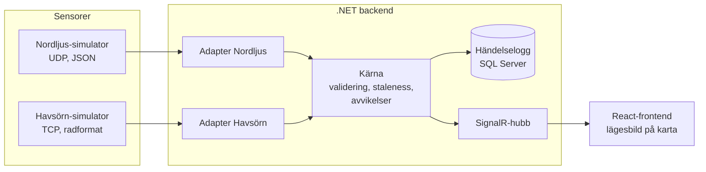

# Nordljus – lägesbild i realtid

> **Status: under uppbyggnad.** En första tunn version fungerar: en simulerad enhet rör sig på lägesbilden, hela vägen från sensor till webbläsare (se [Kör lokalt](#kör-lokalt)). Resten av dokumentet beskriver vad som planeras.

Nordljus är en webbaserad lägesbild för ett påhittat militärt team. Sensorer rapporterar position och status för personal, markfordon och helikoptrar, och operatörer följer dem live på en karta. Systemet är byggt för ett **isolerat nät** utan internet.

Projektet är ett portfolio-case för rollen **Forward Deployed Engineer**. Uppdraget är att sitta med ett produktteam i sex veckor, lösa deras problem och samtidigt bygga något som fler team kan återanvända.

All data är fiktiv.

## Kör lokalt

Kräver [.NET SDK 10](https://dotnet.microsoft.com/download) och Node 24. `docker compose up` kommer i vecka 3; till dess körs delarna i tre terminaler från repots rot:

```bash
dotnet run --project src/Nordljus.Backend      # http://localhost:5076, tar emot UDP på port 5300
dotnet run --project src/Nordljus.Simulator    # skickar Järn 1:s position en gång per sekund
cd frontend && npm ci && npm run dev           # öppna http://localhost:5173
```

En prick märkt "Järn 1 · 1 s sedan" ska röra sig i en cirkel. Stoppa simulatorn: pricken står still och åldern räknas upp. Stoppa backend: sidhuvudet visar att kontakten med servern är borta.

| Variabel            | Standard    | Används av | Vad                              |
| ------------------- | ----------- | ---------- | -------------------------------- |
| `NORDLJUS_UDP_HOST` | `127.0.0.1` | simulatorn | Vart sensordata skickas          |
| `NORDLJUS_UDP_PORT` | `5300`      | simulatorn | UDP-porten som backend lyssnar på |

Alla variabler står också i [.env.example](.env.example). Backendens port ställs in med `Ingest:Udp:Port` i `appsettings.json` (eller miljövariabeln `Ingest__Udp__Port`). `Validation:MaxClockSkew` (standard 5 s) anger hur långt fram i tiden en sensors klocka får gå innan positionen avvisas.

## Problemet

Operatörerna i team Nordljus ser i dag sensordata i en gammal skrivbordsapplikation som läser in en CSV-fil var 30:e sekund. Bilden ligger alltid efter, och leveranser görs genom att någon kopierar filer till en server för hand.

Hela problemformuleringen, med användare och mätbara kriterier, finns i [docs/problem.md](docs/problem.md).

## Krav

| Krav | Vad det betyder |
| --- | --- |
| **Inget internet i drift** | Inga externa API:er, inga CDN:er och inga karttjänster på nätet. Kartor, typsnitt och ikoner ligger lokalt. |
| **Under 1 sekund** | Från att en sensor skickar till att operatören ser det på skärmen. |
| **Spårbarhet** | Varje händelse loggas, så att man i efterhand kan se vad operatören såg och när. |
| **Robusthet** | En sensor som tappar kontakten syns tydligt (Live → Gammal → Tappad). Datan får inte bara frysa. |
| **Återanvändning** | Ett annat team, Havsörn, med ett annat dataformat ska komma igång genom att bara skriva en egen adapter. |

## Stack

| Del | Teknik | Varför |
| --- | --- | --- |
| Backend | C# / .NET 10, ASP.NET Core minimal API | Långtidssupport (LTS) och vanlig stack i försvarsindustrin |
| Realtid | SignalR | Ingår i ASP.NET Core och återansluter automatiskt |
| Ingest | `BackgroundService` som tar emot via UDP och TCP | Liknar riktiga sensorer, och transporten hålls skild från resten |
| Databas | SQL Server via EF Core | Händelselogg där rader bara läggs till och aldrig ändras |
| Loggning | Serilog | Strukturerade loggar som går att söka i |
| Simulator | .NET-konsolapp | Skickar fejkade positioner, tappar ibland kontakten och skickar ibland trasig data |
| Frontend | React + TypeScript + Vite | Komponenter som kan delas mellan teamen |
| Karta | MapLibre GL + lokal PMTiles-fil | Fungerar utan internet och klarar tusentals objekt (WebGL) |
| Test | xUnit och Vitest | |
| Drift | Docker Compose och GitHub Actions | `docker compose up` startar allt, och CI bygger, testar och bygger images vid varje push |

Projektet håller nere antalet beroenden med flit. Varje NuGet- och npm-paket ska motiveras i `docs/dependencies.md`, så att en säkerhetsavdelning kan godkänna dem.

## Arkitektur (planerad)



- **Kontrakt:** Alla adapters översätter sitt råformat till ett gemensamt format, `TrackUpdate`. Kärnan känner bara till kontraktet.
- **Adapter per team:** Ett nytt team skriver en egen adapter och behöver inte röra kärnan.
- **Återanvändbar kartkomponent:** Kartan och `useSituation()` ligger i ett eget paket som flera team kan använda.

Flödet steg för steg, tidsbudgeten och kraven på det isolerade nätet beskrivs i [docs/architecture.md](docs/architecture.md).

## Planerad struktur

```
src/
  Nordljus.Contracts/      gemensamt kontrakt (TrackUpdate, SensorStatus)
  Nordljus.Core/           regler utan I/O: validering, staleness, avvikelser
  Nordljus.Backend/        API, SignalR, ingest, händelselogg
  Nordljus.Simulator/      fejkade sensorer
  Adapters/                en adapter per team (Nordljus, Havsörn)
tests/                     xUnit-tester
frontend/                  React-app och återanvändbar kartkomponent
docs/                      problemformulering, arkitektur, ADR:er, beroenden, workshop
docker-compose.yml
```

## Plan

| Vecka | Fokus | Innehåll |
| --- | --- | --- |
| 1 | Förstå | Problemformulering, frågor till operatörer och utvecklare, arkitekturskiss |
| 2–3 | Bygga | Simulator, backend, lägesbild, Docker Compose och CI |
| 4 | Återanvända | Gemensamt kontrakt, adapters och team Havsörn utan ändringar i kärnan |
| 5 | Hjälpa operatören | Lokal avvikelsedetektering med regler och statistik, prestanda med 5 000 objekt |
| 6 | Lyfta teamet | README, ADR:er och en 30-minuters workshop där teamet lägger till en sensortyp |

Längs vägen dyker det upp krav som i ett riktigt uppdrag: beroenden som ska godkännas, ett mörkt läge som klarar tillgänglighetskraven och en ökning från 200 till 5 000 objekt.

Arbetet följs på [kanban-tavlan](https://github.com/users/knixan/projects/24).

## Klart när

- [ ] `docker compose up` startar simulator, backend och frontend
- [ ] CI går grönt
- [ ] Två team (Nordljus och Havsörn) använder samma kärna
- [ ] Gammal eller saknad data syns tydligt
- [ ] README, ADR:er och workshopupplägg finns
