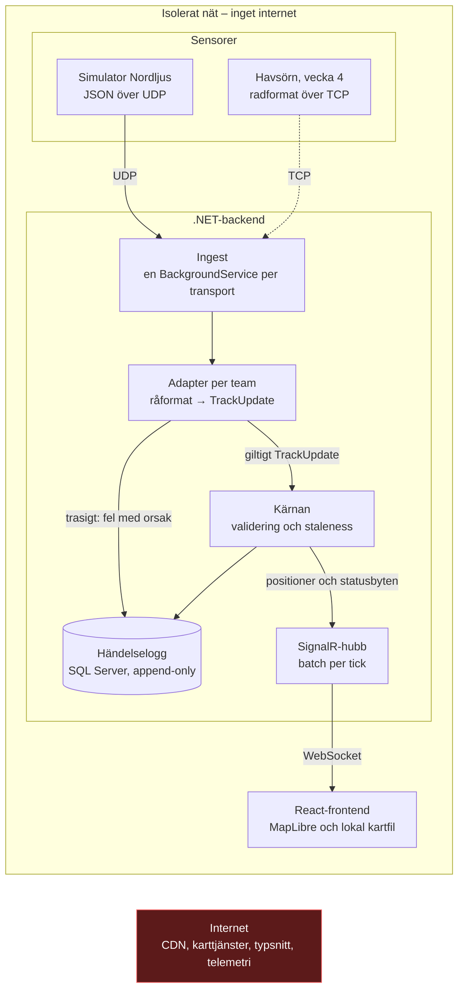
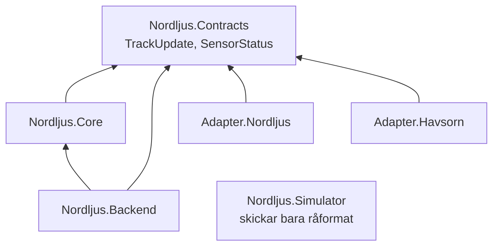

# Arkitektur

_Till team Nordljus och Common Tech. Version 1, vecka 1 – en skiss, inte ett facit._

Här beskrivs hur en position tar sig från en sensor till operatörens skärm, vilka delar som finns och var gränserna går. Varför vi bygger det står i [problem.md](problem.md) och [discovery.md](discovery.md). Större beslut får egna ADR:er i `docs/adr/`.

## Flödet



Internet står utanför med flit. Inga pilar går dit: varken backend eller webbläsaren gör några anrop utåt.

## Steg för steg

| Steg | Del               | Gör                                                                                                    | Ligger i                       |
| ---- | ----------------- | ------------------------------------------------------------------------------------------------------ | ------------------------------ |
| 1    | Sensor            | Skickar ett meddelande ungefär en gång per sekund. I utveckling är det simulatorn.                     | `Nordljus.Simulator`           |
| 2    | Ingest            | Tar emot på UDP eller TCP. Kraschar aldrig på ett trasigt meddelande.                                  | `Nordljus.Backend`             |
| 3    | Adapter           | Översätter teamets råformat till kontraktet `TrackUpdate`, eller returnerar ett fel med orsak.         | `Adapters/Nordljus.Adapter.*`  |
| 4    | Kärnan            | Kontrollerar att värdena är rimliga och räknar ut status: Live, Gammal eller Tappad.                   | `Nordljus.Core`                |
| 5    | Händelselogg      | Sparar varje mottaget meddelande med mottagningstid, källa, rådata och resultat. Raderna ändras aldrig. | `Nordljus.Backend` + SQL Server |
| 6    | SignalR-hubb      | Samlar ändringarna och skickar dem som ett meddelande per tick till alla anslutna.                     | `Nordljus.Backend`             |
| 7    | Frontend          | Ritar om markörerna och visar status med ikon, text och ålder.                                         | `frontend/`                    |

Status (steg 4) räknas inte bara när ett meddelande kommer. En sensor som tystnar skickar ju inget, så kärnan går igenom alla enheter med jämna mellanrum och säger till när någon har blivit _Gammal_ eller _Tappad_. Gränserna står i konfigurationen.

## Tidsbudget

Kravet är under 1 sekund från sensor till skärm. Siffrorna är mål att mäta mot i vecka 3, inte mätvärden.

| Del                              | Mål      |
| -------------------------------- | -------- |
| Nätverk och ingest               | < 10 ms  |
| Adapter och validering           | < 5 ms   |
| Händelselogg                     | < 50 ms  |
| Väntan på nästa tick i hubben    | < 250 ms |
| SignalR till webbläsaren         | < 50 ms  |
| Ritning på kartan                | < 100 ms |
| **Totalt**                       | **< 500 ms** |

Hälften av sekunden är marginal. Det mesta av tiden går åt till att vänta på nästa tick – det är priset för att batcha, och det som gör att 5 000 objekt går att skicka.

## Isolerat nät

Allt som behövs vid körning ligger i repot eller i containrarna:

- **Kartdata** som en lokal PMTiles-fil, inte en karttjänst på nätet.
- **Typsnitt och ikoner** i frontend, inte Google Fonts eller ett ikon-CDN.
- **JavaScript** byggs med Vite och serveras av oss. `index.html` laddar bara lokala filer.
- **Ingen telemetri** i några paket.

Images byggs i CI och förs in i driftnätet. Varje paket motiveras i `docs/dependencies.md`, så att säkerhetsavdelningen kan godkänna det. Kontroll: allt startas med nätverket avstängt, och webbläsarens nätverksflik ska bara visa anrop till vår egen server.

## Beroenden mellan projekten



Pilarna pekar på det projektet refererar till. Allt pekar mot kontraktet, och inget pekar på en adapter. Det är därför Havsörn kan skriva sin egen adapter utan att röra kärnan.

## Frontend

Sidor och komponenter ligger var för sig, och var en komponent ligger säger om den går att återanvända:

```
frontend/src/
  situation-map/              delas med andra team – får inte importera från app/
    components/               situation-map.tsx, track-marker.tsx, status-badge.tsx
    hooks/                    use-situation.ts (SignalR-anslutning och tillstånd)
    types.ts                  speglar kontraktet TrackUpdate
    index.ts                  publikt API – andra importerar bara härifrån
  app/                        appen för Nordljus
    pages/                    en fil per vy: situation-page.tsx, havsorn-page.tsx
    components/               används bara av appen: app-header.tsx, theme-toggle.tsx
    app.tsx                   väljer vilken sida som visas
  theme.css                   färger som CSS-variabler
```

- **En sida** sätter ihop komponenter och bestämmer layouten. Den har så lite logik som möjligt.
- **En komponent** vet inte vilken sida den ligger på. Den får det den behöver via props eller en hook.
- **Ska den delas med Havsörn?** Då ligger den i `situation-map/` och exporteras från `index.ts`. Annars ligger den i `app/components/`.
- Ett test ligger bredvid filen det testar: `track-marker.test.tsx`.
- Ingen router från början. Två vyer går att välja med ett enkelt tillstånd i `app.tsx`. Behövs fler sidor senare tas det upp som ett paket enligt `add-dependency`.

Frontend ser bara kontraktet, aldrig teamens råformat.

## Öppna frågor

1. **Hur hittar backend en adapter utan att referera till den?** Antingen laddas adaptern från en mapp enligt konfigurationen, eller så finns ett tunt startprojekt som refererar till backend och alla adapters. Avgörs i vecka 4 med en ADR.
2. **Ska hubben vänta på att händelseloggen har skrivits?** Att vänta ger säkrast spårbarhet. Att inte vänta ger lägst latens. Mäts i vecka 3, innan vi bestämmer oss.
3. **Hur långt ska ett tick vara?** 250 ms är en startpunkt. Det prövas med 5 000 objekt i vecka 5.
